  

  

  

  
  
  
  

---

## 🌾 About me

- 🎓 **Education:** M.Sc. Horticulture, DDU Gorakhpur University (2025, CGPA 8.5) • B.Sc. Agriculture
- 📚 **Founder, [Agrigence](https://www.agrigence.in):** an open-access, peer-reviewed journal of agricultural research and innovation
- 📱 **Building the Agrigence exam prep platform** for Indian agriculture exams (IBPS AFO, ICAR JRF, UPSSSC AGTA, State PSC), on web and Android
- 🌱 **Consultant, Fivearth Farms Pvt. Ltd.** (Alwar, Rajasthan): project reports, certification documents and farm planning for an integrated organic farm
- 🏅 **Organic standards:** NPOP, USDA and EU certification documentation
- 💻 **Developer side:** web and Android apps, Mac apps in Swift, AI developer tools in Python
- 📍 **Based in:** India

---

## 🌾 About Agrigence ([agrigence.in](https://www.agrigence.in))

Agrigence is my own platform for Indian agriculture. It has two parts:

**1. Agrigence Exam Prep** (web + Android app)
- 📱 **Get the app:** [Agrigence on Google Play](https://play.google.com/store/apps/details?id=in.agrigence.cv)
- 🎯 Built for agriculture competitive exams: **IBPS AFO, ICAR JRF, UPSSSC AGTA and State PSC**
- 📝 Full-length mock tests with instant scoring
- ✅ Detailed, step-by-step solutions after every test
- 🆓 Free tests available, and you can start without signing up
- 🌐 Bilingual questions (Hindi and English)
- 📊 Test analysis and leaderboards to track progress
- 🤖 AI-based MCQ generator from PDFs and documents (premium)
- 🔔 Push notifications and an exam timer inside the app

**2. Agrigence Journal**
- 📖 Open-access, international journal of agricultural research and innovation
- 🔍 Peer-reviewed publishing, so research is free for anyone to read
- 🧑‍🔬 Built for students, researchers and scientists in agriculture and allied fields

---

## 💼 Experience

**Agricultural consulting and documentation, Fivearth Farms Pvt. Ltd.**
- Detailed Project Reports (DPRs) for bank and subsidy submissions
- SOPs and certification pathway mapping for NPOP, USDA and EU organic standards
- Crop and variety planning for semi-arid conditions (polyhouse, shade net, open field, agroforestry)
- Farm layout planning, vendor research, cold storage and solar sizing studies
- Government scheme research: AIF, PMKSY, PMFME, NHM/MIDH
- Farm management dashboards, KPI frameworks and meeting action trackers

**Founder, Agrigence Journal**
- Editorial setup, ISSN application and compliance, editorial board documents
- Website, SEO and brand strategy

**Founder and developer, Agrigence exam platform**
- Test series, bilingual questions, test analysis and leaderboards
- AI-based MCQ generator from PDFs and documents
- Payments, push notifications and Play Store release

---

## 🌱 Agriculture expertise

  
  
  
  
  
  
  
  
  
  

## 🧰 Developer tools

  

---

## 🚀 Featured projects

  

  
  

---

## 📊 Most used languages

  

