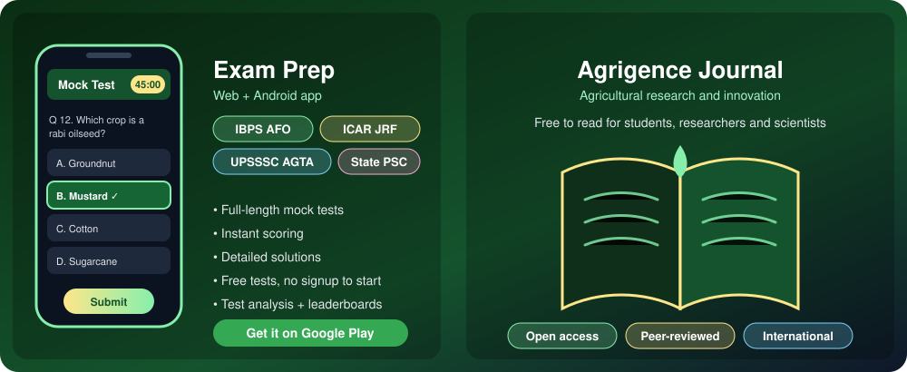

<h3><code>sarvesh@github ~ $ ./contributions.sh</code></h3>

  

<h3><code>sarvesh@github ~ $ whoami</code></h3>
<table>
  <tr>
    <td valign="top"></td>
    <td valign="top"></td>
  </tr>
</table>

 

  

  

<h3><code>sarvesh@github ~ $ cat agrigence.md</code></h3>

**1. Agrigence Exam Prep** (web + Android app) at [agrigence.in](https://www.agrigence.in)
- 📱 **Get the app:** [Agrigence on Google Play](https://play.google.com/store/apps/details?id=in.agrigence.cv)
- 🎯 Built for **IBPS AFO, ICAR JRF, UPSSSC AGTA and State PSC**
- 📝 Full-length mock tests with instant scoring
- ✅ Detailed, step-by-step solutions after every test
- 🆓 Free tests available, and you can start without signing up
- 🌐 Bilingual questions (Hindi and English)
- 📊 Test analysis and leaderboards to track progress
- 🤖 AI-based MCQ generator from PDFs and documents (premium)
- 🔔 Push notifications and an exam timer inside the app

**2. Agrigence Journal**
- 📖 Open-access, international journal of agricultural research and innovation
- 🔍 Peer-reviewed publishing, so research is free for anyone to read
- 🧑‍🔬 Built for students, researchers and scientists in agriculture and allied fields

<h3><code>sarvesh@github ~ $ cat experience.md</code></h3>

**Agricultural consulting and documentation, Fivearth Farms Pvt. Ltd.**
- Detailed Project Reports (DPRs) for bank and subsidy submissions
- SOPs and certification pathway mapping for NPOP, USDA and EU organic standards
- Crop and variety planning for semi-arid conditions (polyhouse, shade net, open field, agroforestry)
- Farm layout planning, vendor research, cold storage and solar sizing studies
- Government scheme research: AIF, PMKSY, PMFME, NHM/MIDH
- Farm management dashboards, KPI frameworks and meeting action trackers

**Founder, Agrigence Journal**
- Editorial setup, ISSN application and compliance, editorial board documents
- Website, SEO and brand strategy

**Founder and developer, Agrigence exam platform**
- Test series, bilingual questions, test analysis and leaderboards
- AI-based MCQ generator from PDFs and documents
- Payments, push notifications and Play Store release

**Education**
- M.Sc. Horticulture, DDU Gorakhpur University (2025)
- B.Sc. Agriculture

<h3><code>sarvesh@github ~ $ ls projects/</code></h3>

| Project | What it is | Stack |
|---|---|---|
| [**Agrigence**](https://www.agrigence.in) | Research journal and exam prep for Indian agriculture | TypeScript |
| [**dynamo-mac**](https://github.com/anksarvesh-lgtm/dynamo-mac) | Turns the MacBook notch into a control center for media and devices | Swift |
| [**agent-guard**](https://github.com/anksarvesh-lgtm/agent-guard) | Local MCP server that keeps AI coding agents running reliably, with no telemetry | Python |

<h3><code>sarvesh@github ~ $ ./contact.sh</code></h3>

- 🌐 [agrigence.in](https://www.agrigence.in)
- ▶️ [YouTube: @The.Techool](https://www.youtube.com/@The.Techool)
- 📸 [Instagram: @aslisarvesh](https://www.instagram.com/aslisarvesh/)
